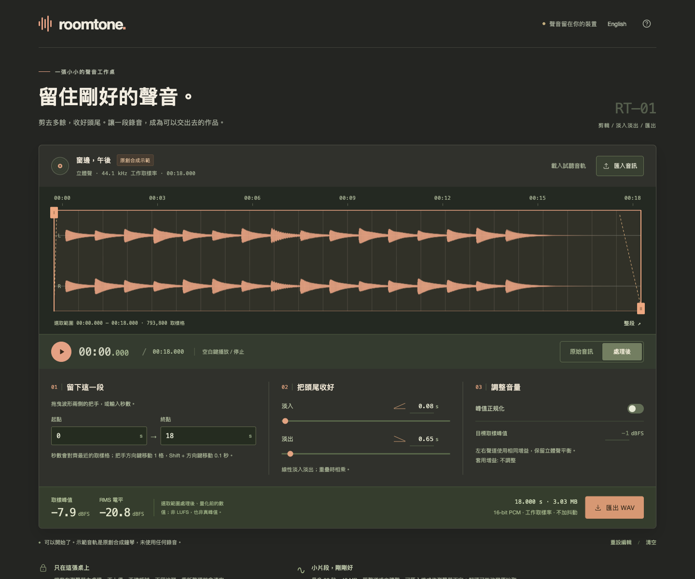

# Roomtone

[Open Roomtone](https://miiduoa.github.io/roomtone/)
A small audio desk. Trim the extra, soften the edges, and take a finished WAV with you.

[繁體中文](../README.md) · [Browser verification](browser-verification.md)



## The desk

Open or drop a short audio file, select a range using waveform handles or exact time fields, add linear fades, and optionally normalize its sample peak. Compare the same selection before and after processing, then export a mono or stereo 16-bit PCM WAV. Traditional Chinese is the default; every control, error, and help message has an English version.

The included bell study is original deterministic synthesis, not a recording. No uploads, accounts, external fonts, analytics, or third-party APIs. Only the language preference is stored; audio stays in memory and disappears on refresh.

## Run locally

Node.js 24 or newer:

```sh
npm ci
npm run dev
```

Open the printed URL at `/roomtone/`. Use `npm test` for engine and lifecycle tests; `npm run build` checks TypeScript and builds `dist/`.

## Signal path

Selection boundaries are integer sample frames: `[in, out)`. Time inputs snap to the nearest frame. Arrow keys on a handle move one frame; Shift + arrow moves 0.1 seconds; Home and End jump to legal boundaries. Space plays or stops when focus is outside a control.

The processing order is **selection → linear fades → linked peak normalization → PCM16 export**. Overlapping fades multiply. Normalization measures the largest absolute sample across both channels and applies one shared gain; silence remains silence. Source samples are never modified.

Meters report the processed selection’s sample peak and RMS across all channel samples, before quantization. They are **not LUFS or true peak**. Samples beyond ±1 saturate at export; the UI warns about these samples. Processed preview uses exactly the same quantized, saturated PCM16 samples as export, although the playback device can resample them. Export has no dither; negative full scale maps to −32768 and positive full scale to 32767.

## Boundaries

- Maximum 90 seconds, 40 MB, mono or stereo, 18 million decoded samples; supported working rates are 8–192 kHz.
- Import support for WAV, MP3, M4A, OGG, FLAC, and other encodings depends on the browser.
- A local media metadata preflight rejects normal long recordings before PCM decoding. Unreadable metadata and timeouts produce errors. Decoded length, channels, and samples are checked again. Browser decoding may resample to its audio context rate, so export retains the **decoded working sample rate**, not a promised original rate.
- `decodeAudioData()` cannot be cancelled. A file with inaccurate metadata can still allocate substantial decoder memory before its decoded limits are checked. Stale results are ignored when another import supersedes them.
- Rapid edits use revision/request checks so old background results cannot replace the current selection. Invalid trim input reverts to the committed value.
- This is a short-clip finishing tool, not a multitrack editor. See [browser verification](browser-verification.md) for the browsers actually exercised; responsive layout is not a claim of full cross-browser certification.

## Internals and checks

`src/audio.ts` contains pure PCM processing, measurement, synthesis, and WAV serialization. A module worker performs rendering. `src/preflight.ts` handles local duration checks, timeout, cancellation, and object-URL cleanup. The UI and playback live in `src/main.ts`; text lives in `src/i18n.ts`.

Tests cover frame boundaries, channel-linked gain, overlapping fades, one-frame selections, silence, invalid numbers, PCM16 saturation, RIFF fields and interleaving, preview/export parity, stale worker requests, and metadata cleanup. DSP unit tests do not verify physical audio playback.

## Publish with GitHub Pages

Set **Settings → Pages → Source** to **GitHub Actions**. Pushes to `main` run locked dependency installation, tests, and the production build on Node 24, then deploy `dist/`. Pull requests validate without deploying. The Vite base is `/roomtone/`; update it if the repository name changes.

References: [Web Audio decoding and resampling](https://developer.mozilla.org/en-US/docs/Web/API/BaseAudioContext/decodeAudioData), [buffer playback](https://developer.mozilla.org/en-US/docs/Web/API/AudioBufferSourceNode/start), [PCM format fields](https://learn.microsoft.com/en-us/windows/win32/api/mmreg/ns-mmreg-waveformatex).

MIT © 2026 Miiduoa
